<div align="center">

<h1></h1>

<p>
Glide Aholic is a local server for seven specific Guild Wars 2 client builds.<br>
It implements login, character creation and saves, map exploration, movement and multiplayer chat.<br>
Combat is experimental.
</p>

<p>
  <a href="https://discord.gg/F9wnQ5Yaw6"></a>
  <a href="https://github.com/noggaholic/glide-aholic/actions/workflows/build.yml"></a>
</p>
<p>
  <a href="#requirements"></a>
  <a href="glide.props"></a>
  <a href="#supported-clients"></a>
  <a href="LICENSE"></a>
</p>

<p>
  <a href="#screenshots">Screenshots</a> &middot;
  <a href="#supported-clients">Supported clients</a> &middot;
  <a href="#setup">Setup</a> &middot;
  <a href="#commands">Commands</a> &middot;
  <a href="#components">Components</a> &middot;
  <a href="#development">Development</a>
</p>

<hr>

## Screenshots

| Build 14075 | Build 14422 | Build 14505 | Build 14812 |
| :---: | :---: | :---: | :---: |
| <a href="docs/screenshots/14075/character-selection.png">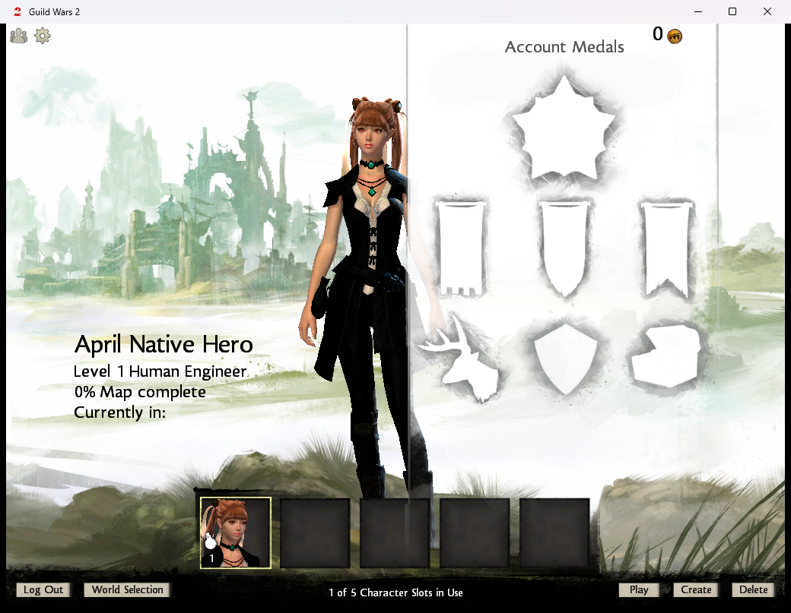</a><br><a href="docs/screenshots/14075/in-game.png">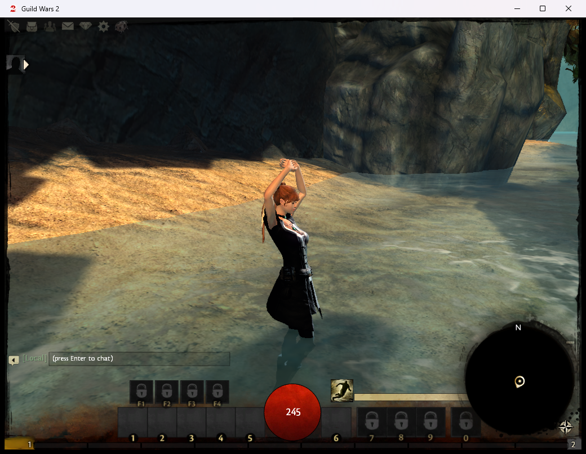</a> | <a href="docs/screenshots/14422/character-selection.png">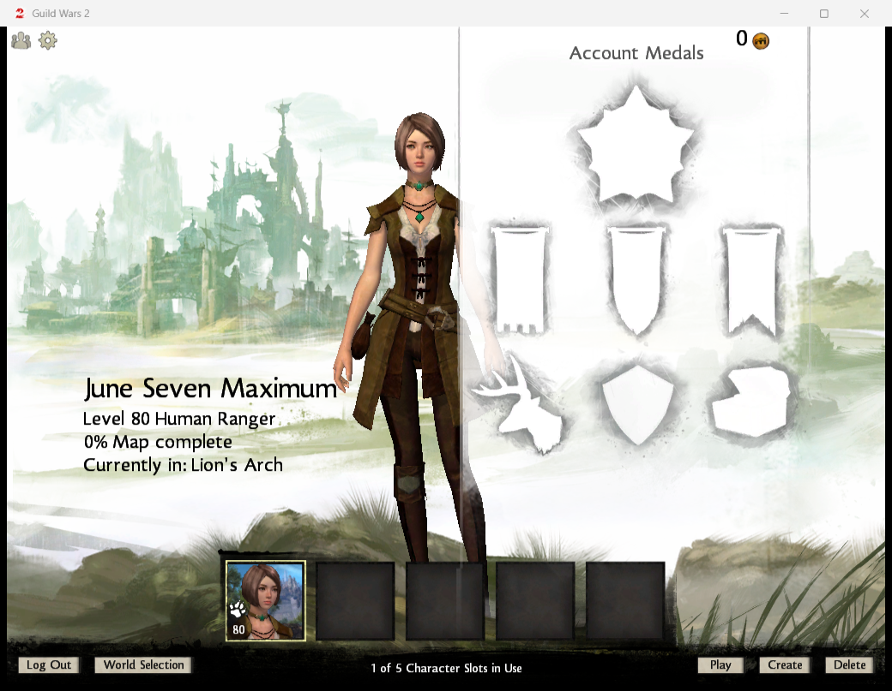</a><br><a href="docs/screenshots/14422/in-game.png">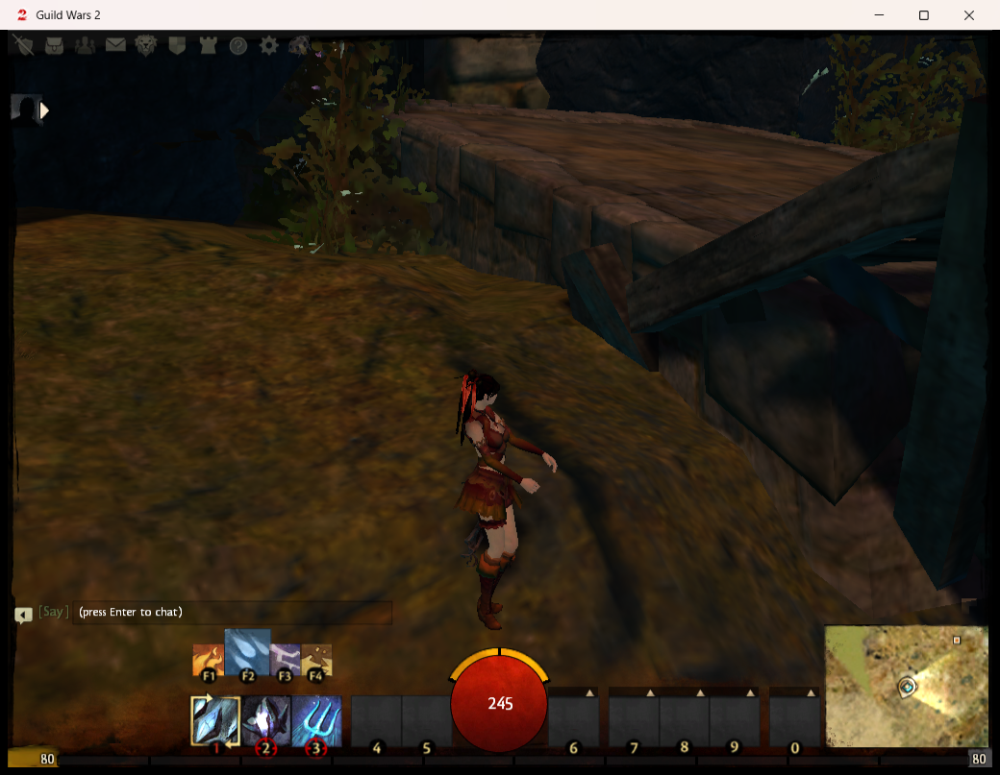</a> | <a href="docs/screenshots/14505/character-selection.png">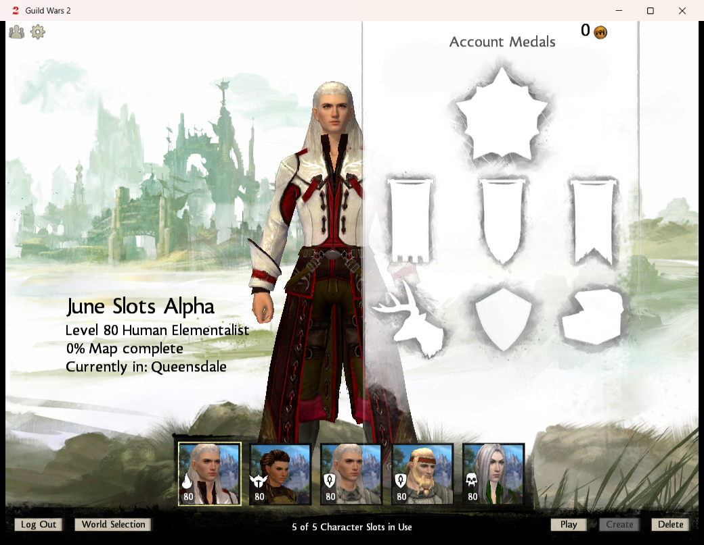</a><br><a href="docs/screenshots/14505/in-game.png">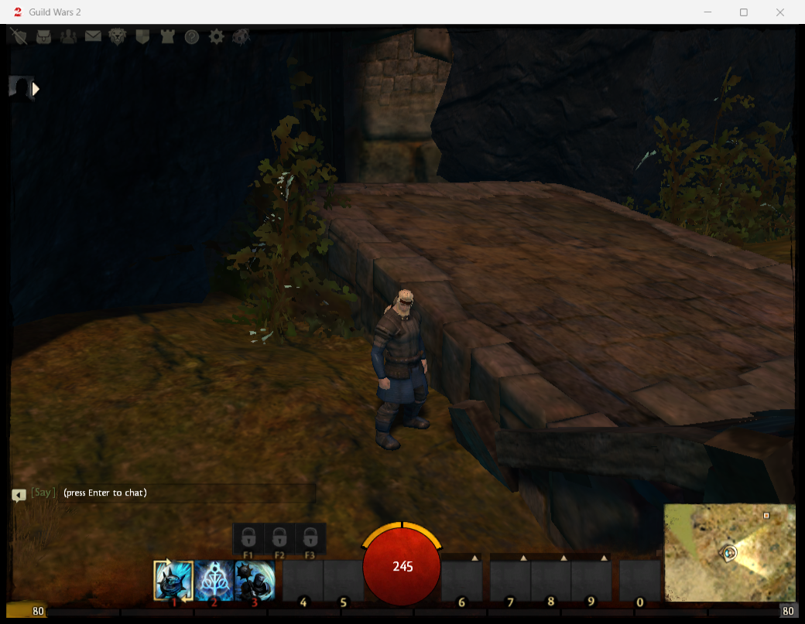</a> | <a href="docs/screenshots/14812/character-selection.png">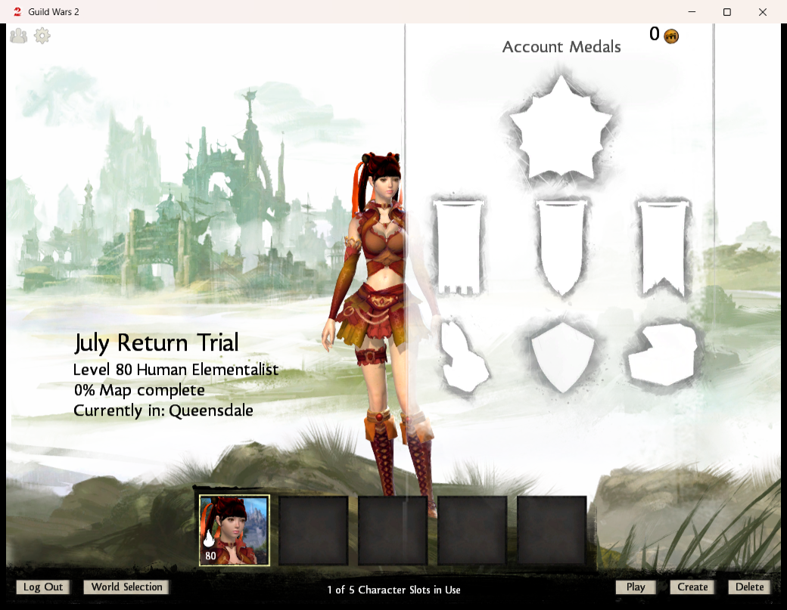</a><br><a href="docs/screenshots/14812/in-game.png">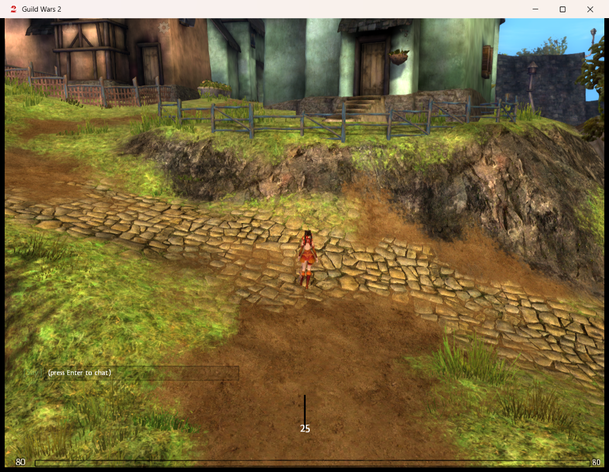</a> |

| Build 49284 | Build 167409 | Build 204489 |
| :---: | :---: | :---: |
| <a href="docs/screenshots/49284/character-selection.png">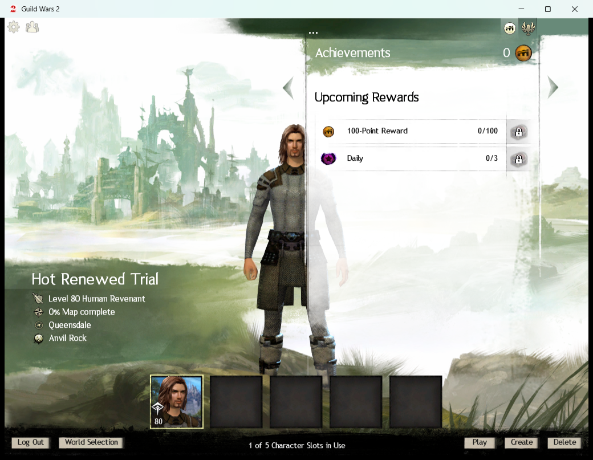</a><br><a href="docs/screenshots/49284/in-game.png">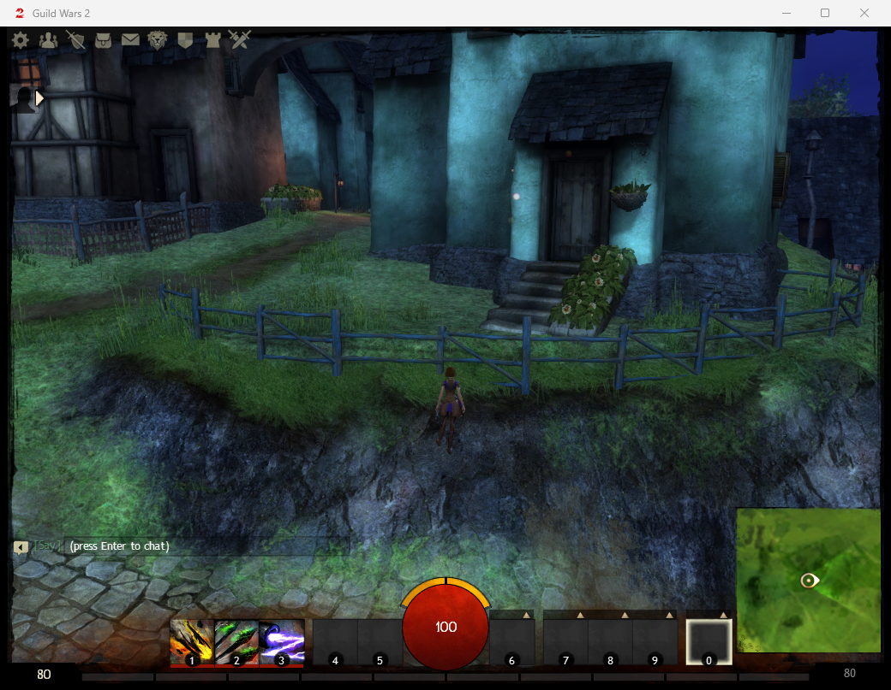</a> | <a href="docs/screenshots/167409/character-selection.png">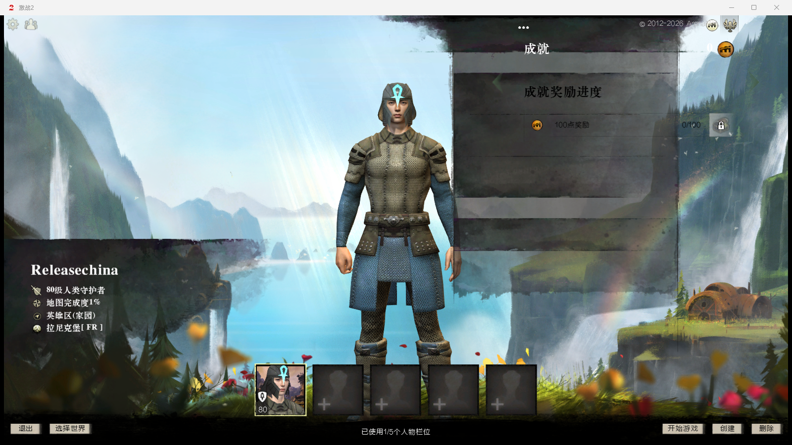</a><br><a href="docs/screenshots/167409/in-game.png">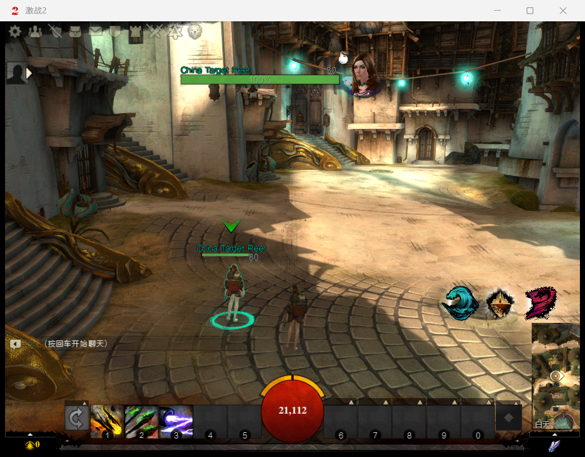</a> | <a href="docs/screenshots/204489/character-selection.png">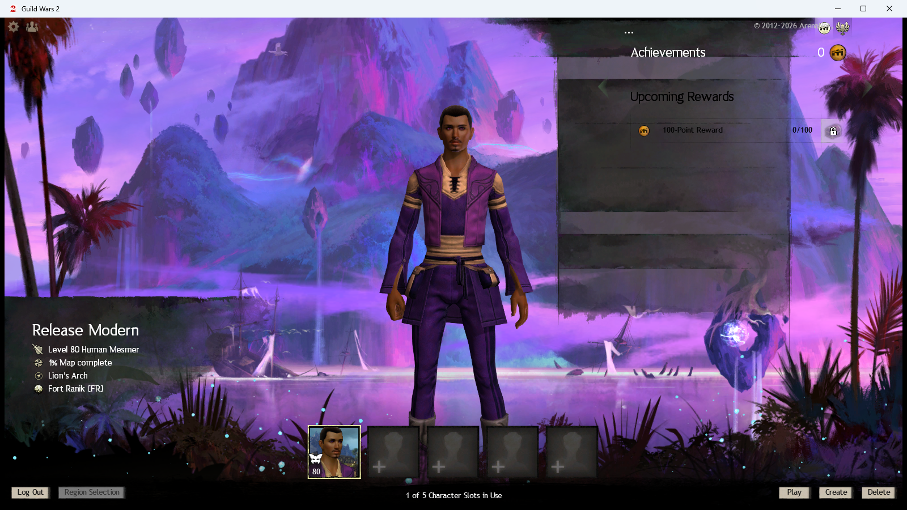</a><br><a href="docs/screenshots/204489/in-game.png">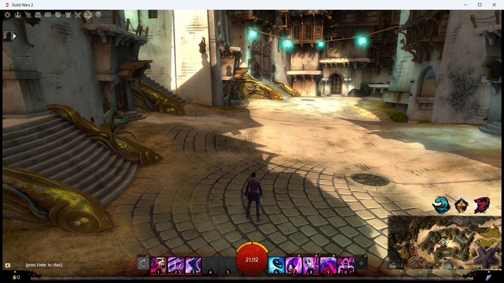</a> |

</div>

## Supported clients

| Build | Build date | Executable | Gliding | Mounts |
|---:|:---:|---|:---:|:---:|
| 14075 | 04-25-2012 | `Gw2.exe` | No | No |
| 14422 | 06-07-2012 | `Gw2.exe` | No | No |
| 14505 | 06-15-2012 | `Gw2.exe` | No | No |
| 14812 | 07-20-2012 | `Gw2.exe` | No | No |
| 49284 | 05-26-2015 | `Gw2.exe` | Yes | No |
| 167409 | 08-23-2024 | `Gw2-64.exe` | Yes | Yes |
| 204489 | 07-22-2026 | `Gw2-64.exe` | Yes | Yes |

Dates are executable PE timestamps in UTC (`mm-dd-yyyy`). Compatibility is limited
to the executable hashes in [the build profiles](builds/executable_profiles.cpp).
An executable with the same build number but a different hash may be rejected.

The server and all connected clients must use the same build. Accounts and saves
are separate for each build. Maps require the corresponding files in the game
installation, even if they appear in the catalog.

## Requirements

- Windows x64.
- A supported game installation with its executable, `Gw2.dat` and browser files.
  Build 49284 also needs compatible Coherent UI components.
- A matching Glide data package in the installation, or an import pack to add with
  [`complete`](#missing-local-data).
- To compile, Visual Studio 2017 Build Tools or a later Visual Studio installation
  with MSVC v141 for x86/x64 and Windows SDK 10.0.17763.0. MinHook is included.

Game files and import packs are supplied separately. Glide does not download them.

## Setup

Run the commands in PowerShell from the repository root. The example uses build
204489. For another build, change `$build`, `$client` and the launcher path in step 5.

### 1. Compile

```powershell
.\build.bat Release x64
```

This builds both Win32 and x64 programs. Keep `bin/Win32/Release/` and
`bin/x64/Release/` together. Skip compilation when using the Windows binary package.

### 2. Prepare data

```powershell
$build = 204489
$client = 'C:\Games\GW2-204489\Gw2-64.exe'

.\bin\x64\Release\glide-catalog.exe prepare "$client" --build $build --out data
```

`prepare` reads the completed installation offline and writes `data/<build>/`
without changing the installation. The game installation must remain available
when playing. Existing output files are accepted only if their contents match.
Resolve preparation errors before starting the server.

#### Missing local data

If preparation reports missing local data, `complete` can add the matching import
pack to a copy of the installation. The pack must contain `installation.txt` and
every file listed in it:

```text
format=1
build=<build-number>
data=<relative-path>|<byte-size>|<lowercase-sha256>
```

Choose a new output directory outside the source installation and import pack,
with enough space for a full copy of the game archive:

```powershell
.\bin\x64\Release\glide-catalog.exe complete "$client" --inputs "C:\GW2-inputs\$build" --out "C:\Games\GW2-$build-complete"
```

The source installation is unchanged. Set `$client` to the executable in the new
copy and run `prepare` again. Use that executable when launching too. If completion
is interrupted, rerun the same command to resume the `.pending` directory.

### 3. Create an account

With the server stopped:

```powershell
.\bin\x64\Release\glide-accounts.exe --build $build --email player@local.test
```

Enter a password at the prompt. Accounts, characters and saved positions are stored
in `state/`. Add `--force` to update an existing password, or use `--list` with
`--build` to list accounts.

**Passwords are stored in plain text. Use a password that is not used elsewhere.**

### 4. Start the server

```powershell
.\bin\x64\Release\glide-server.exe --config server\server.cfg --build $build
```

The default address is `127.0.0.1:6112`.
[`server/server.cfg`](server/server.cfg) sets the address, port, data folder,
save folder and log file.

### 5. Launch the game

In a second PowerShell terminal at the repository root:

```powershell
.\bin\x64\Release\glide-launcher.exe 'C:\Games\GW2-204489\Gw2-64.exe' --windowed --server 127.0.0.1:6112
```

Log in with the local account, then create or select a character. Keep the launcher
open while playing. Closing it or pressing Ctrl+C in its terminal closes its clients.

For multiplayer, create an account for each player before starting the server and
launch clients of the same build. Set `--server` to the server address if it differs
from the default.

Stop the server with Ctrl+C. Repeat steps 2–5 to run another build.

## Commands

Enter commands in game chat. `.help` lists commands available for the current build.
`.help worldport`, for example, shows the arguments for `.worldport`.

### All seven builds

| Command | Description |
|:---|:---|
| `.help [command]` | List commands or show help for one command. |
| `.gps` | Show the current map and coordinates. |
| `.heading` | Show the facing direction. |
| `.status` | Show character and server state. |
| `.maps [text or ID] [--page N]` | Find maps by name or ID. |
| `.mapinfo [mapId]` | Show details for a map. |
| `.who` | List online players. |
| `.where <player name>` | Show an online player's map and coordinates. |
| `.inspect <player name>` | Show an online player's position and movement state. |
| `.announce <message>` | Send a message to all players. |
| `.worldport <x y z>`<br>`.worldport <mapId> [x y z]` | Travel to a map or coordinates. |
| `.up [heightDelta]` | Move vertically. Defaults to +100. |
| `.forward [distance]` / `.fw [distance]` | Move forward. Defaults to 100. |
| `.backward [distance]` / `.bw [distance]` | Move backward. Defaults to 100. |
| `.tele <player name>` | Travel to another player. |
| `.bring <player name>` | Bring a player to the current location. |
| `.bringall` | Bring all other players to the current location. |
| `.tpall <mapId> [x y z]` | Move all players, including the sender, to a map. |
| `.mark <name>` | Save the current location as an account marker. |
| `.marks` | List saved locations. |
| `.unmark <name>` | Delete a saved location. |
| `.go <name>` | Travel to a saved location. |
| `.timeofday [HH:MM[:SS]]` | Show or set the shared time of day. |
| `.combat [on\|off]` | Show or toggle experimental player combat. Resets on leaving the world. |

### Build-specific commands

| Command | Description | 14075 | 14422 | 14505 | 14812 | 49284 | 167409 | 204489 |
|---|---|:---:|:---:|:---:|:---:|:---:|:---:|:---:|
| `.glider <designId>` | Save a glider from the local catalog. Redeploy to see the change. | — | — | — | — | ✓ | ✓ | ✓ |
| `.mount <skinId>` | Ride a mount from the local catalog. | — | — | — | — | — | ✓ | ✓ |
| `.unmount` | Dismount. | — | — | — | — | — | ✓ | ✓ |

Glider and mount IDs must exist in the local catalog.

## Components

| Component | Source | Role |
|---|:---|:---|
| `glide-server.exe` | `server/` | Handles login, characters, maps, movement, chat and commands. |
| `glide-launcher.exe` | `launcher/` | Verifies the executable, creates a separate working folder, starts the game and loads the client DLL. |
| `glide-client.dll` | `client/` | Runs inside the game to connect it to Glide and handle controls and resources for that build. |
| `inject32.exe` | `inject32/` | Lets the x64 launcher load the DLL into 32-bit clients. |
| `glide-catalog.exe` | `catalog/` | Completes installations from import packs and prepares server data. |
| `glide-accounts.exe` | `accounts/` | Creates and lists accounts, and updates passwords. |
| `glide-common.lib` | `common/` | Shared archive, file, encryption and networking code linked into the programs. |

[`builds/`](builds/) contains each build's executable profiles, function offsets,
protocol code and resource manifests. [`glide.props`](glide.props) holds shared
compiler and linker settings for the projects in [`GlideAholic.sln`](GlideAholic.sln).

Generated files are kept in `bin/` and `build/`. `data/` contains prepared catalogs
and resources, `runtime/` holds the launcher's game working folders, and `state/`
contains accounts and saves.

## Development

Python is required for the quality tools and distribution checks.

[`quality.ps1`](quality.ps1) runs clang-format and Cppcheck. Run `.\quality.ps1 -Install`
to install the pinned tools under `dependencies/quality/` and check the code.
Subsequent checks use `.\quality.ps1`. Add `-FixFormat` to apply the
[formatting rules](.clang-format).

[GitHub Actions](https://github.com/noggaholic/glide-aholic/actions/workflows/build.yml)
runs formatting, static analysis, the distribution check and Release builds for
Win32 and x64. CI uses v143 with the installed Windows SDK.

[`release.ps1`](release.ps1) builds source and Windows ZIPs in `dist/`, using
[`release-files.txt`](release-files.txt) as the source inventory. Packaging requires
current verification records for preparation, login, map entry and movement on all
seven builds. [`scripts/check_distribution.py`](scripts/check_distribution.py)
checks source files and finished ZIPs for stored instruction patterns.

## Credits and license

Author: Karliky / BugCraft.

[Issues](https://github.com/noggaholic/glide-aholic/issues)

Original project code is licensed under [GPL-3.0-or-later](LICENSE).
[Third-party notices](THIRD_PARTY_NOTICES.md) cover bundled code and other references.

Guild Wars 2 and its assets, including the artwork shown in screenshots, belong to
their respective owners and are not covered by the project's GPL license. Glide
Aholic is unofficial and is not affiliated with ArenaNet or NCSOFT.
