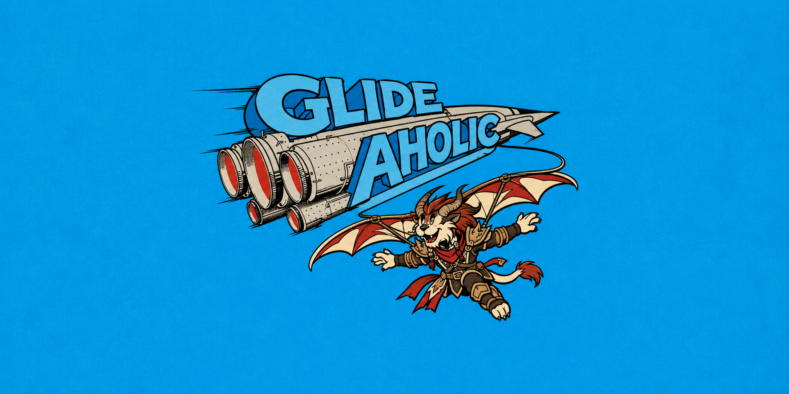

<div align="center">

<h1></h1>

<p><strong>A local exploration and multiplayer server for seven exact client builds.</strong></p>
<p>Create a character. Explore together. Pick up where you left off.</p>

<p>
  <a href="https://github.com/noggaholic/glide-aholic/actions/workflows/build.yml"></a>
  <a href="#requirements"></a>
  <a href="glide.props"></a>
  <a href="LICENSE"></a>
</p>
<p>
  <a href="#supported-clients"></a>
  <a href="https://discord.gg/F9wnQ5Yaw6"></a>
</p>

<p>Created by <strong>Karliky / BugCraft</strong></p>

<p>
  <a href="#quick-start">Quick start</a> &middot;
  <a href="#supported-clients">Supported clients</a> &middot;
  <a href="#commands">Commands</a> &middot;
  <a href="#project-layout">Project layout</a> &middot;
  <a href="#troubleshooting">Troubleshooting</a>
</p>

</div>

> [!NOTE]
> Compatibility is limited to the exact executable profiles listed below; the
> updated retail client is not supported. Supply your own game files and matching
> import pack. Glide does not download them.

## At a glance

| Feature | What you can do |
|---|---|
| **Characters & saves** | Create and select characters; keep your progress and positions between sessions. |
| **Multiplayer** | See other players, chat and explore together on the same build. |
| **Map exploration** | Travel between available maps, teleport and save named locations. |
| **Gliders & mounts** | Use the local catalog on builds that support them. |
| **Experimental combat** | Try combat with other players using `.combat`. |

## Requirements

- Windows x64.
- To compile: Visual Studio 2017 Build Tools, or a later Visual Studio with
  **MSVC v141 x86/x64** and **Windows SDK 10.0.17763.0**. MinHook is included.
- An installation of one of the builds below, with its executable, `Gw2.dat`,
  browser files and matching Glide data package. Build 49284 needs compatible
  Coherent UI components. Builds 167409 and 204489 need their browser files.

Glide does not download game files or import packs. You supply those separately.
The launcher checks the executable's SHA-256 hash. A different executable with the
same build number may be rejected.

## Supported clients

| Build | Build date | Executable | Gliding | Mounts |
|---:|:---:|---|:---:|:---:|
| 14075 | 04-25-2012 | `Gw2.exe` | No | No |
| 14422 | 06-07-2012 | `Gw2.exe` | No | No |
| 14505 | 06-15-2012 | `Gw2.exe` | No | No |
| 14812 | 07-20-2012 | `Gw2.exe` | No | No |
| 49284 | 05-26-2015 | `Gw2.exe` | Yes | No |
| 167409 | 08-23-2024 | `Gw2-64.exe` | Yes | Supported |
| 204489 | 07-22-2026 | `Gw2-64.exe` | Yes | Supported |

Build dates come from executable PE timestamps in UTC (`mm-dd-yyyy`). Use the same
build for the server and every connected client. Each build has its own accounts.
You can visit maps whose resources are present in your game installation.

## Quick start

**Compile → prepare data → create an account → start the server → launch the game.**

Run these commands in PowerShell from the repository root. For another build,
change `$build`, `$client` and the executable path in step 5.

### 1. Compile

```powershell
.\build.bat Release x64
```

This builds both Win32 and x64 programs. Keep `bin/Win32/Release/` and
`bin/x64/Release/` together. Skip this step if you have the Windows binary package.

### 2. Prepare local data

```powershell
$build = 204489
$client = 'C:\Games\GW2-204489\Gw2-64.exe'

.\bin\x64\Release\glide-catalog.exe prepare "$client" --build $build --out data
```

This reads the game installation and creates `data/<build>/`. It works offline
and leaves the installation unchanged. Keep that installation available.
Preparation stops if existing output files differ. Continue only after it
succeeds with exit code 0.

<details>
<summary><strong>Preparation reports a missing Glide data package?</strong></summary>

If preparation reports a missing Glide data package, supply an import pack for
your build. It must contain `installation.txt` and the files listed in it:

```text
format=1
build=<build-number>
data=<relative-path>|<byte-size>|<lowercase-sha256>
```

Use a new output directory with enough space for a full copy of the game archive:

```powershell
.\bin\x64\Release\glide-catalog.exe complete "$client" --inputs "C:\GW2-inputs\$build" --out "C:\Games\GW2-$build-complete"
```

Set `$client` to the executable in the new copy, then run `prepare` again. If
completion is interrupted, rerun the same command to resume the `.pending` copy.
The source installation stays unchanged. You still need the original game files
for any maps you want to load.

</details>

### 3. Create an account

With the server stopped:

```powershell
.\bin\x64\Release\glide-accounts.exe --build $build --email player@local.test
```

Enter a test password when prompted. Create each account once per build. Accounts
and characters are saved in `state/`.

> [!IMPORTANT]
> Passwords are stored in plain text. Use a password you do not use elsewhere.

### 4. Start the server

```powershell
.\bin\x64\Release\glide-server.exe --config server\server.cfg --build $build
```

Leave this terminal open. The server listens on `127.0.0.1:6112` by default.
Change the address and port in `server/server.cfg` if needed.

### 5. Launch the game

Open a second PowerShell terminal in the same project directory:

```powershell
.\bin\x64\Release\glide-launcher.exe 'C:\Games\GW2-204489\Gw2-64.exe' --windowed --server 127.0.0.1:6112
```

Keep the launcher open. Log in with the account you created, then create or select
a character and enter a map. To play with another client, create a second account
before starting the server and launch a second client of the same build.

Walk, jump and try `.gps` in chat. Exit and reconnect to check that your character
and position were saved. Close the clients and press **Ctrl+C** in the server
terminal to stop it. To test another build, repeat steps 2 to 5.

## Commands

Press **Enter** for chat. Use `.help command` for arguments, such as
`.help worldport`.

```text
.help           List available commands
.gps            Show your current map and coordinates
.mark camp      Save your current location as "camp"
.go camp        Return to that saved location
```

### Commands available on all seven builds

| Command | Purpose |
|---|---|
| `.help [command]` | List commands or show help for one command. |
| `.gps` | Show your map and coordinates. |
| `.heading` | Show the direction you are facing. |
| `.status` | Show character and server state. |
| `.maps [text or ID] [--page N]` | Find maps by name or ID. |
| `.mapinfo [mapId]` | Show details for a map. |
| `.who` | List online players. |
| `.where <player name>` | Show a player's map and coordinates. |
| `.inspect <player name>` | Show a player's position and movement state. |
| `.announce <message>` | Send a message to all players. |
| `.worldport <x y z>`<br>`.worldport <mapId> [x y z]` | Travel to a map or coordinates. |
| `.up [heightDelta]` | Move vertically. |
| `.forward [distance]` / `.fw [distance]` | Move forward. |
| `.backward [distance]` / `.bw [distance]` | Move backward. |
| `.tele <player name>` | Travel to another player. |
| `.bring <player name>` | Bring a player to your location. |
| `.bringall` | Bring all other players to your location. |
| `.tpall <mapId> [x y z]` | Move all players to a map. |
| `.mark <name>` | Save a named location. |
| `.marks` | List your saved locations. |
| `.unmark <name>` | Delete a saved location. |
| `.go <name>` | Travel to a saved location. |
| `.timeofday [HH:MM[:SS]]` | Show or set the shared time of day. |
| `.combat [on\|off]` | Show or toggle experimental combat with other players. |

### Commands by build

**✓** Available · **—** Unavailable

| Command | Purpose | 14075 | 14422 | 14505 | 14812 | 49284 | 167409 | 204489 |
|---|---|:---:|:---:|:---:|:---:|:---:|:---:|:---:|
| `.glider <designId>` | Choose a glider from the local catalog. | — | — | — | — | ✓ | ✓ | ✓ |
| `.mount <skinId>` | Ride a mount from the local catalog. | — | — | — | — | — | ✓ | ✓ |
| `.unmount` | Dismount. | — | — | — | — | — | ✓ | ✓ |

Glider and mount IDs must exist in the local catalog.

## Troubleshooting

| Problem | What to check |
|---|---|
| **Compilation fails** | Install MSVC v141 x86/x64 and Windows SDK 10.0.17763.0. |
| **Preparation fails** | Check the data package, archive and browser files for your build. Fix the error before launching. |
| **Executable rejected** | Its hash must match a profile in [`builds/executable_profiles.cpp`](builds/executable_profiles.cpp). |
| **Login fails** | The account, server and client must use the same build. |
| **Map fails to load** | The installation must contain the map's resources. A map can appear in the catalog even when some files are missing. |

## Project layout

| Artifact | Source | Purpose |
|---|---|---|
| `glide-server.exe` | `server/` | Handles login, characters, maps, movement, chat and commands. |
| `glide-launcher.exe` | `launcher/` | Checks the game executable, creates a separate folder to run it, starts the game and loads the DLL. Keep it open while playing. |
| `glide-client.dll` | `client/` | The launcher loads this into the game to connect it to Glide and apply the controls and resource handling for its build. |
| `inject32.exe` | `inject32/` | The x64 launcher starts this helper to load the DLL into 32-bit clients. |
| `glide-catalog.exe` | `catalog/` | `complete` adds an import pack to a game installation. `prepare` reads that installation and creates the data files Glide needs. |
| `glide-accounts.exe` | `accounts/` | Creates and lists accounts. Use `--force` to update a password. Stop the server before using it. |
| `glide-common.lib` | `common/` | Shared code for files, archives, encryption and networking, compiled into the programs. |

<details>
<summary><strong>Repository files and local folders</strong></summary>

| Entry | Purpose |
|---|---|
| `builds/` | Code and settings for each client build, including executable hashes, function offsets, message formats and required files. |
| `server/server.cfg` | Server address, port, data folder, save folder and log file. |
| `tests/` | Tests for the code and release packages. Includes `glide-check.exe`, built separately from the programs above. |
| `vendor/` | MinHook source and its license notices. |
| `.github/` | GitHub Actions configuration for builds, formatting, static analysis and tests. |
| `GlideAholic.sln`, `*/.vcxproj` | The Visual Studio solution and each component's C++ project file. |
| `glide.props` | Compiler, linker and output folder settings shared by the C++ projects. |
| `build.bat` | Finds MSBuild and compiles the programs for the chosen configuration and architecture. |
| `quality.ps1` | Runs clang-format and Cppcheck. `-Install` downloads these tools. `-FixFormat` formats the code. |
| `.clang-format` | C/C++ formatting rules used by the quality script. |
| `release.ps1` | Checks release inputs and builds matching source and Windows ZIPs. |
| `release-files.txt` | Lists the source files included in release packages. |
| `.gitignore` | Keeps generated output, local game data, accounts and credentials out of Git. |
| `.gitattributes` | Git text-file and line-ending rules. |
| `README.md` | Setup and usage instructions. |
| `LICENSE` | GPL-3.0-or-later license for original project code. |
| `THIRD_PARTY_NOTICES.md` | Licenses and credits for third-party code. |

These folders are created locally and ignored by Git:

| Directory | Contents |
|---|---|
| `bin/` | Compiled programs, DLLs, libraries and debug symbols for each architecture and configuration. |
| `build/` | Temporary build files, code quality reports and test files. |
| `data/` | Catalogs, content and client resources generated by `prepare` for each build. |
| `runtime/` | Game working folders created by the launcher. |
| `state/` | Accounts, characters and saved progress for each build. |
| `dependencies/` | clang-format and Cppcheck installed by `quality.ps1`. |
| `dist/` | Source and Windows ZIPs, checksums and release test records. |

`.git/` stores Git history and repository settings.

</details>

## Community

Join [BugCraft on Discord](https://discord.gg/F9wnQ5Yaw6) to talk about the project,
or [open an issue](https://github.com/noggaholic/glide-aholic/issues) to report a bug.

## License

Original project code is [GPL-3.0-or-later](LICENSE).
See [third-party notices](THIRD_PARTY_NOTICES.md).
Guild Wars 2 and its assets belong to their respective owners. This project is
unofficial and is not affiliated with ArenaNet or NCSOFT.
