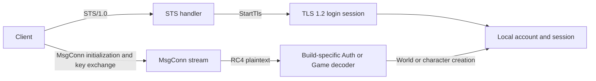

# Transport

## Connections

The local listener separates STS and MsgConn by the first received byte. A `P`
starts an STS request. Other input enters the binary MsgConn handshake. STS login
and binary Auth/Game traffic use separate connections. TLS does not wrap the
MsgConn connections.

## Build profiles

The STS SDK build is separate from the executable build. An SDK alias alone
cannot distinguish all clients.

| Client build | STS SDK | Login mode | Password XML | MsgConn program | Key record | Server frames |
|---:|---:|---|---|---:|---|---|
| 14075 | 1002 | TLS password/SRP | Not used | 101 | Fixed 66 bytes | No |
| 14422 | 1002 | TLS password/SRP | Not used | 101 | Fixed 66 bytes | No |
| 14505 | 1002 | TLS password/SRP | Not used | 101 | Fixed 66 bytes | No |
| 14812 | 1002 | TLS password/SRP | Not used | 101 | Sized/aligned | No |
| 49284 | 1004 | SSO over TLS | Base64 | 101 | Sized/aligned | Yes |
| 167409 | 1004 | SSO over TLS | Base64 | 111 | Fixed 66 bytes | Yes |
| 204489 | 1004 | SSO over TLS | Base64 | 101 | Fixed 66 bytes | Yes |

TLS is required before login. Password authentication completes through
`/Auth/LoginFinish`. SSO uses a resumed TLS session and `/Auth/StartSsoLogin` or
`/Auth/Resume`. The TLS version is `0x0303` (TLS 1.2). The two login modes use
different cipher suites and MAC lengths.

The local resumed TLS session and MsgConn use public, fixed key material.
Never use an ArenaNet account or password with a local server.

## STS envelope

A request begins with `P {path} STS/1.0`, followed by CRLF-separated headers and
CRLF CRLF before its body. Header `l` or `L` is a required decimal body length.
Header `s` or `S` supplies an optional sequence. Text after its first semicolon is
discarded. Duplicate length or sequence headers are rejected.

The parser bounds the header terminator offset to 16,384 bytes and the body to
1 MiB. Paths must begin with `/`, contain no spaces or control characters and be
shorter than 160 bytes. Sequences must be shorter than 64 bytes. The body length
counts bytes, not Unicode characters. The decoder reports exactly one consumed
request, retaining any following request for the next iteration.

A normal response begins with `STS/1.0 {status} {status_text}`, followed by
`s:{sequence}R`, `l:{body_bytes}` and CRLF CRLF. A missing sequence suppresses the
reply. Successful Connect and Ping have no reply. StartTls has a special
`400 Success` response before the TLS handshake. STS status codes are distinct from HTTP status codes.

Presence SetWatch additionally writes a notification with only `l:{body_bytes}`
and CRLF CRLF before the XML body. It has no status line or sequence. A suppressed
reply does not suppress this notification. Error replies include an XML Error
with code 4. Routes absent from the shared handler and the profile's explicit
empty-service list receive 404 after the session guards.

The XML helper extracts exact named tags. Its limits apply to decoded UTF-8 bytes.
It rejects duplicate opening tags, nested markup in a selected value, unknown
entities and invalid UTF-8. It is not a general XML schema validator. Request
pages list the XML values used by each route. Other body fields are unknown.

## Binary messages and framing

MsgConn initialization starts with little-endian U16, U16, U32 build, U32 program
and U32 extension length. The stream accepts extension lengths 4 and 72, counting
the length word itself. A subsequent key-exchange record is either 66 fixed bytes
or a sized record with type zero, total length 2..66 and payload aligned to four
bytes, as selected by the profile.

After the local key exchange, independent incoming and outgoing RC4 states
process the stream. Individual decoded messages start with a little-endian U16
ID. There is no universal message-length field. The build, direction, scene and
session state select the layout used to find the next message.

Where Server frames is Yes, an uncompressed frame consists of U16 zero, U16
payload length and the payload bytes, encrypted with RC4. Where it is No, the
payload is encrypted directly without that frame header. These server frames
are not LZ4-compressed.
